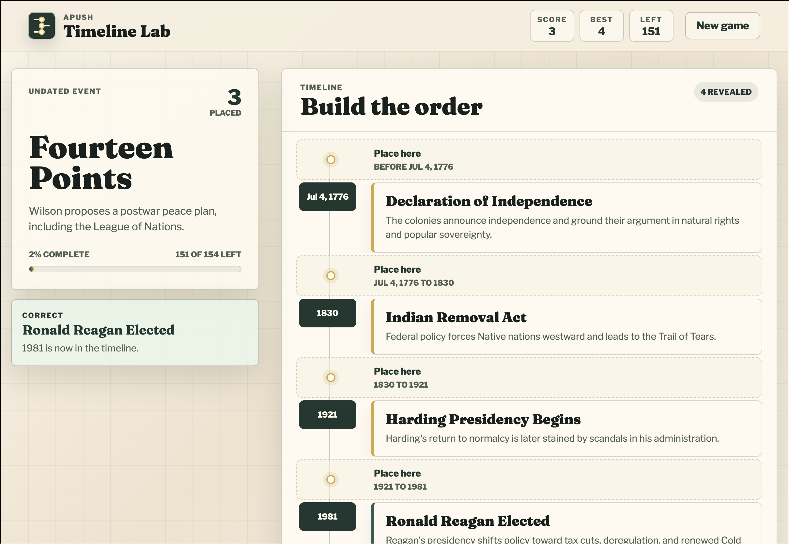

# APUSH Timeline Lab

APUSH Timeline Lab is a simple browser game for practicing U.S. history chronology. Players place undated APUSH events into a growing timeline and get instant feedback.



## Impact

Turns timeline review into active practice, helping students remember event order, context, and cause-and-effect faster than flashcards alone.

## Run

```bash
npm install
npm run dev
```
